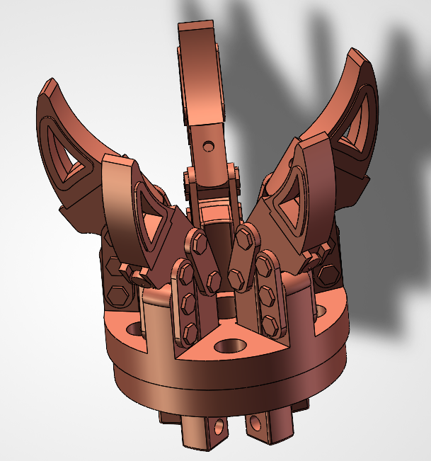

# 五爪夹（Five-Claw Gripper）

> 基于 SolidWorks 的五爪机械夹爪三维设计，包含完整的零件建模与装配体。

## 项目简介

本项目是一个**五爪机械夹爪**的完整三维设计，采用「底座 — 腕关节 — 爪腕 — 夹具」的多级传动结构，通过销钉定位与连接件将各部件装配为一个整体，并利用镜像对称设计实现结构对称、受力均衡。

## 结构组成

整套夹爪由 **13 个零件、2 个装配体**组成，按功能可分为以下几部分：

- **爪式底座**（`9爪式底座`）：整个夹爪的安装基础，用于固定与支撑。
- **腕部传动**（`8腕关节`、`7链接腕`、`10爪腕`）：连接底座与末端爪指的关节与腕部结构，负责力的传递与姿态调整。
- **夹持爪指**（`6夹具`）：末端执行件，实现抓取功能。
- **连接与定位**（`1连接件`、`2连接件`、`3定位销`、`4短轴销`、`5固定销`）：用于各部件之间的连接、定位与固定，保证装配精度。
- **支撑盖**（`11右支撑盖`、`镜向11右支撑盖`）：起支撑与防护作用，采用**镜像对称**设计，保证左右结构一致。

## 设计特点

- **镜像对称设计**：支撑盖等部件采用镜像建模，结构对称、受力均衡、外观规整。
- **模块化零件划分**：按功能拆分为底座、腕关节、爪指、销钉、支撑盖等模块，便于装配与维护。
- **销钉精确定位**：通过定位销、短轴销、固定销实现各零件之间的精确装配定位。

## 软件环境

- **建模软件**：SolidWorks
- **文件格式**：`.SLDPRT`（零件）、`.SLDASM`（装配体）

## 文件结构

| 文件名 | 类型 | 说明 |
| --- | --- | --- |
| `1连接件.SLDPRT` | 零件 | 连接件 |
| `2连接件.SLDPRT` | 零件 | 连接件 |
| `3定位销.SLDPRT` | 零件 | 定位销 |
| `4短轴销.SLDPRT` | 零件 | 短轴销 |
| `5固定销.SLDPRT` | 零件 | 固定销 |
| `6夹具.SLDPRT` | 零件 | 夹持爪指 |
| `7链接腕.SLDPRT` | 零件 | 链接腕 |
| `8腕关节.SLDPRT` | 零件 | 腕关节 |
| `9爪式底座.SLDPRT` | 零件 | 爪式底座 |
| `10爪腕.SLDPRT` | 零件 | 爪腕 |
| `11右支撑盖.SLDPRT` | 零件 | 右支撑盖 |
| `镜向11右支撑盖.SLDPRT` | 零件 | 镜像右支撑盖 |
| `装配体3.SLDASM` | 装配体 | 装配体 |
| `装配体4.SLDASM` | 装配体 | 最终装配体 |

## 预览

## 使用方式

1. 使用 SolidWorks 打开 `装配体4.SLDASM` 查看完整装配体；
2. 各零件文件（`.SLDPRT`）可单独打开查看建模特征与尺寸；
3. 如需修改，请在 SolidWorks 中编辑后重新保存上传。

## 许可

<!-- 如需开源，可添加许可证，例如 MIT License -->
